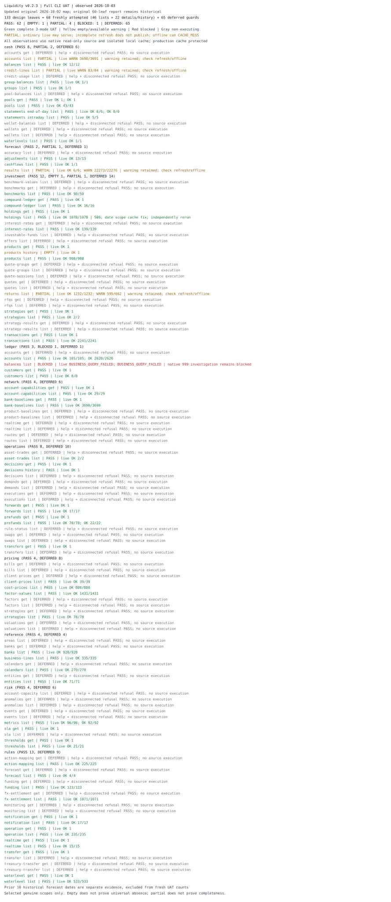

# Liquidity inherited executable-leaf CLI UAT

Observed: 2026-10-02
Scope: general
Status: snapshot

Updated: 2026-10-03 (Asia/Shanghai; initial observation retained)

Latest acceptance: [2026-10-03 full Liquidity v0.2.3 CLI UAT](2026-10-03-liquidity-full-cli-uat.md) freshly exercises all 68 executable leaves and checks all 65 deferred leaves. The original [roadmap link](../../assets/general/2026-10-02-liquidity-inherited-cli-uat-roadmap.svg) now presents that full execution. Results below retain the earlier inherited run and targeted follow-ups as historical evidence.

## Result and accounting

Observed execution timestamps are UTC; selected native business dates are separately retained in private evidence and are not inferred from the report date.

The public catalog contains 68 executable business leaves. The initial 2026-10-02 execution covered **60 inherited leaves** (39 lists, 21 detail/history leaves): **44 PASS, 1 EMPTY, 11 PARTIAL, 4 BLOCKED, 0 NOT_ATTEMPTED**.

After the targeted 2026-10-03 follow-ups, the cumulative selected-scope status is **55 PASS, 1 EMPTY, 3 PARTIAL, 1 BLOCKED, 0 NOT_ATTEMPTED**. Nine list leaves moved from PARTIAL to PASS after adopting pageSize=5000 (10 scopes including ledger INNER and OUTER). The separately authorized four-block investigation then moved interest-rates and decisions history to PASS and returns to PARTIAL; ledger balances remains BLOCKED by native business refusals. The other 47 leaves retain their initial evidence and were not freshly rerun in these follow-ups. Status never covers every production account or date.

The eight release additions have earlier verification and are excluded from today’s inherited UAT. The 65 deferred leaves were not executed. The three withdrawn getter designs are absent from active discovery; absence is not successful execution. Counts come from current `LIST_LEAVES`/`DETAIL_LEAVES` plus each leaf’s actual public help, not a candidate catalog or the historical graph.

No systemic authentication/network pause occurred. All 60 inherited routes have actual live, refresh and disconnected-offline outcomes in the final evidence. This completes the execution matrix, not acceptance of every leaf: partial, empty and blocked outcomes remain explicitly non-green.

## Method and protected boundaries

Actual user configuration resolved to a Liquidity CDP source, and `auth check --domain liquidity` verified a healthy authenticated headless browser on CDP 9222 before business inquiries. The user’s existing browser/profile configuration was reused; Chrome was not launched, switched or repaired. The harness invoked the current public CLI entry in process, equivalent to the repository `.venv/bin/dogopencli`; a missing ambient PATH entry is not a user CLI failure.

A private copy preserves the actual configuration except for `cache.path`, redirected to a new private SQLite database. No credentials, authentication, browser, source registry or production transport were substituted. All live calls use the unmodified product inquiry transport. Before browser work, the documented CDP supplement and referenced launcher were read; neither DI nor its reserved CDP ports were used.

The planned matrix for each list uses `--live --all --require-complete`, explicit public refresh, then matching disconnected `--all --require-complete`; the table distinguishes actually completed modes from modes not attempted. The initial execution kept the then-declared per-leaf widths. The first authorized follow-up changes nine list declarations to pageSize=5000; the separately authorized four-block work also uses 5000 for both returns variants; total reconciliation and identities remain unchanged, with no count normalization or incomplete publication. Offline installs a transport factory that throws on any attempt to open the browser; saved results record zero calls. Each genuine detail/history document uses live, independent detail refresh and disconnected offline. A pre-refresh CACHE_MISS check proves a list row is not silently substituted for a native detail.

Checks go beyond exit status: complete/source/CDP/non-simulated metadata, returned/matched counters, publication, matching refresh/offline snapshot IDs and counts, private-cache read-only behavior, and native parser identity validation. History/detail counters describe one document; nested history entry counts are reported separately. Live and refreshed acquisition are separate source observations; any changed content is disclosed, not silently treated as a stable snapshot.

Original config unchanged: **True**. Original cache/database sidecars unchanged: **True**. The checks are file fingerprints; no production cache was opened for writing.

The initial execution produced only private UAT artifacts and this sanitized report/roadmap. The subsequent user-authorized correction sets nine list page widths to 5000 in `leaves.py`; this follow-up updates the report/map and verifies that correction. Production config/cache, login/browser management, version, staging, commit, push, PR, mutation, export and DI remain untouched. Existing unrelated worktree edits are preserved.

## 2026-10-03 large-page follow-up

The user authorized native pageSize=5000 for investment transactions/benchmarks, rules funding/fx-settlement/waterlevel, ledger accounts, and reference banks/business-lines/entities. All nine use their actual public declarations and production inquiry transport, without process-local page-width overrides. Investment holdings was initially deferred at pageSize=10; the user subsequently confirmed that native pageSize=100 and 500 both work effectively and efficiently and authorized adopting 500. Its current declaration is now pageSize=500; the separate update below records that provenance.

The verified strict-live step used `--live --all --require-complete`, with one native page in each of 10 scopes. This report update adds actual public refresh into a new isolated private cache and matching disconnected `--all --require-complete`. All 30 three-mode outcomes have exit 0, complete=true, CDP/non-simulated provenance and reconciled counters. Each refresh published a complete capture; every offline result matched its refresh snapshot ID/count, preserved the private cache and made zero browser contacts. Original production configuration/database/sidecar fingerprints remained unchanged. Live evidence was acquired in the preceding verified step, not rerun or relabelled here.

Initial deficits are preserved below; the main matrix now shows the latest accepted outcomes for these nine leaves. The four formerly BLOCKED rows are superseded by the separate fix follow-up below; remaining rows retain the initial run's evidence.

| Public route | Initial acquired/reported (pageSize=10) | Follow-up live (pageSize=5000) | Three-mode status |
| --- | --- | --- | --- |
| `liquidity investment transactions list` | 2205/2241 | 2241/2241 | PASS |
| `liquidity investment benchmarks list` | 49/50 | 50/50 | PASS |
| `liquidity rules funding list` | 106/123 | 123/123 | PASS |
| `liquidity rules fx-settlement list` | 1048/1071 | 1071/1071 | PASS |
| `liquidity rules waterlevel list` | 419/533 | 533/533 | PASS |
| `liquidity ledger accounts list` | INNER 2499/2620; OUTER 105/105 | 105/105<br>2620/2620 | PASS |
| `liquidity reference banks list` | 702/928 | 928/928 | PASS |
| `liquidity reference business-lines list` | 327/335 | 335/335 | PASS |
| `liquidity reference entities list` | 70/71 | 71/71 | PASS |

Native diagnostics independently observed cross-page repetitions at width 1000 for transactions (2241 arrivals, 2240 unique) and ledger INNER (2620 arrivals, 2618 unique); width 5000 returned complete sets. This supports avoiding those pagination boundaries, not a claim that the backend was repaired. Unique ordering/read consistency and larger-than-5000 scopes remain unverified; existing completeness/identity checks continue to refuse bad acquisitions. Holdings tail sampling also observed five repetitions, but both 1000 and 5000 probes timed out. Those 1000/5000 timeouts do not invalidate the user's later confirmation that 100/500 work effectively. The current holdings declaration now uses 500; its historical three-mode PARTIAL row is retained with that provenance, rather than counted as a newly executed UAT.

Follow-up live-to-refresh content changes: liquidity rules funding list.

Private follow-up evidence: `tmp/partial-diagnosis-20261002T212349Z/` contains strict-live CLI records and native request/page counts; `tmp/large-page-cache-uat-20261002T213128Z/` contains `leaf-*-refresh.json`, `leaf-*-offline.json`, `summary.json`, `acceptance-audit.json`, isolated config/cache and protected-file fingerprints. Directory mode is 0700 and artifact mode is 0600; business literals stay private. The follow-up stems in the matrix refer to these directories.

## Four-block diagnosis and fix follow-up — 2026-10-03

This is the separately authorized investigation of the four initial BLOCKED leaves, not a fresh run of all 60 leaves. Genuine original scopes/identities were reused; live inquiries and refresh publication used the product transport and a new private cache. The interest-rate/accrual/history live, refresh and disconnected-offline commands all pass. Cash returns ordinary live and refresh deliberately exit 1 with available rows; strict live refuses the incomplete result; disconnected offline correctly reports CACHE_MISS. These outcomes comprise 13 saved CLI calls across four scopes in three leaves. Ledger diagnostics are separate native offset probes and are not counted as complete CLI UAT.

| Initial blocker | Verified cause and correction | Latest selected-scope outcome |
| --- | --- | --- |
| interest-rates offline 0/137 | Native effectiveDate is ISO YYYY-MM-DD; the missing series_format compared it against compact YYYYMMDD windows. Declare the native format and reuse strict date normalization; existing captures remain readable without rewriting them. | PASS: live / refresh / offline 137/137; original UAT cache also replays 137/137 without browser access or cache changes. |
| decisions history INVALID_RESPONSE | Native getHistory returns a list of version objects, whose row IDs differ from the current report ID. Accept that native container and independently query getDetail to validate the requested current ID; every version must match its reportId, groupId and tenant, with typed version IDs. Isolate the corrected cache contract. | PASS: one native history document with one entry in all three modes; matching refresh/offline snapshot. No list-row substitution or fabricated request identity. |
| returns pagination/count failures | Both native queries now use pageSize=5000. Accrual returns 1231 unique rows with reported_total=1231 in one page. Cash returns 595 native/parsed/unique rows while reporting 662, already in the first page; its response pageSize echo is 0. This deficit exists before CLI parsing or cache filtering. | PARTIAL overall: accrual passes all three modes at 1231/1231; cash ordinary live and refresh expose 595/662 with INCOMPLETE_RESULT, complete=false and exit 1. Refresh has published=false and unchanged private cache; strict live emits no rows, offline CACHE_MISS. |
| ledger balances business refusal | Original OUTER width-10 acquisition fails at rowStart=20, INNER at rowStart=840. First-page width-10 queries succeed; widths 1000/3000/5000 fail. Width-1 probes reproduce native success=false / errorCode=999 / 未知异常 at OUTER offsets 23,25,28,29 and INNER offsets 840,841,842, while adjacent offsets succeed. Correct the additional native ISO valueDate format defect, but preserve the business refusal. | BLOCKED: full ledger acquisition has no safe client workaround established. Failed positions are not skipped or published as complete. Date-format regression checks pass, but do not establish live ledger acceptance. |

Returns now follows the existing cash-account incomplete-result contract: available data and truthful counters for ordinary live, strict refusal when completeness is required, and no incomplete refresh publication. Fake-CDP regressions separately prove preservation of an existing complete returns capture for both bases. Production cash returns had no previous complete capture; its actual proof is preservation of the same private database containing the other complete captures, not an artificially seeded production result.

The ledger positional pattern is evidence of a native backend failure for the sampled scope, not proof of the failing record's internal cause. The response supplies only a generic 999 exception, without a usable underlying stack. A backend correction is required before retrying complete ledger UAT; increasing page width alone cannot close this blocker. Returns cash likewise needs native count/data reconciliation before it can become PASS.

Private evidence: `tmp/four-block-fix-uat-20261002T215412Z/` contains actual public CLI outputs, isolated config/cache, summary and preservation audit. Native returns/ledger page probes are in `tmp/large-page-diagnosis-20261002T214117Z/`, ledger first-page probes in `tmp/large-page-diagnosis-20261002T214517Z/`, large-width refusals in `tmp/large-page-diagnosis-20261002T214713Z/`, OUTER single-row probes in `tmp/large-page-diagnosis-20261002T215003Z/` and INNER single-row probes in `tmp/large-page-diagnosis-20261002T215725Z/`. Request selectors, account identities and business data remain private. All original configuration/cache fingerprints remain unchanged; offline makes zero browser contacts.

## Holdings page width update — 2026-10-03

The user confirms that native widths 100 and 500 both work effectively and efficiently, and explicitly selects pageSize=500 for `investment holdings list`. The product declaration now uses 500 for live and refresh, with native offsets 0/500/1000 as required by the scope. This supersedes the prior instruction to retain width 10 and defer investigation.

The update relies on the user's verification; no new production inquiries or full UAT were performed here. Initial width-10 outcomes remain explicitly historical in the matrix, and the cumulative three-mode UAT counts remain unchanged. The prior 1000/5000 timeouts are separate observations, not evidence against the confirmed 100/500 widths. Identity validation, source-total reconciliation, strict completeness checks and complete-only cache publication are preserved.

Configuration verification: 72 focused local tests passed (capability, collector and inherited CLI SIT), including native 500-row offsets, multi-page synthetic refresh/offline capture and cross-page overlap refusal. Ruff lint/format, Doc Guard (88 Markdown files), whitespace and report/SVG status reconciliation passed; the SVG was rendered and inspected. These checks do not represent a new production acquisition.

## Per-leaf evidence

For native-counter list counts, notation is returned/reported. Cash flows and metric series declare a complete single response without a native total; their displayed CLI counter is derived cardinality, not an independently reported backend total. Detail counters count one native document, followed by nested entry count when applicable. Scope labels deliberately omit real identifiers, account numbers, amounts and raw request/response values. Evidence stems refer to the ignored private directory below; each mode has its own JSON record.

| # | Public route | Selected scope | Live | Refresh | Disconnected offline | Status | Private evidence |
| ---: | --- | --- | --- | --- | --- | --- | --- |
| 1 | `liquidity cash accounts list` | declared current full scope | INCOMPLETE_RESULT; acquired 3690/3691, rows not emitted | INCOMPLETE_RESULT; 3690/3691 | CACHE_MISS | PARTIAL | `leaf-00-scope-*` |
| 2 | `liquidity cash waterlevels list` | one observed account | complete 1/1 | complete 1/1 | complete 1/1 | PASS | `leaf-01-scope-*` |
| 3 | `liquidity cash statements intraday list` | one archived populated business-day scope; one observed account | complete 5/5 | complete 5/5 | complete 5/5 | PASS | `leaf-02-scope-*` |
| 4 | `liquidity forecast cashflows list` | one archived populated business-day scope; one observed account | complete 1 rows; no native total | complete 1 rows; no native total | complete 1 rows; no native total | PASS | `leaf-03-scope-*` |
| 5 | `liquidity forecast adjustments list` | declared current full scope | complete 13/13 | complete 13/13 | complete 13/13 | PASS | `leaf-04-scope-*` |
| 6 | `liquidity operations forwards list` | declared current full scope | complete 17/17 | complete 17/17 | complete 17/17 | PASS | `leaf-05-scope-*` |
| 7 | `liquidity operations asset-trades list` | one archived populated business-day scope | complete 2/2 | complete 2/2 | complete 2/2 | PASS | `leaf-06-scope-*` |
| 8 | `liquidity operations prefunds list` | archived status set APPROVED,CLOSED<br>archived status set SUBMITTED,REJECTED,CLOSED_SUBMITTED | complete 70/70<br>complete 22/22 | complete 70/70<br>complete 22/22 | complete 70/70<br>complete 22/22 | PASS | `leaf-07-scope-*` |
| 9 | `liquidity investment products list` | declared current full scope | complete 908/908 | complete 908/908 | complete 908/908 | PASS | `leaf-08-scope-*` |
| 10 | `liquidity investment holdings list` | initial business-day scope; outcomes below are historical; current pageSize=500 adopted after user confirmation of 100/500 | INCOMPLETE_RESULT; acquired 1073/1078, rows not emitted | INCOMPLETE_RESULT; acquired 1073/1078, rows not emitted | CACHE_MISS | PARTIAL | `leaf-09-scope-*` |
| 11 | `liquidity investment transactions list` | declared current full scope; follow-up 2026-10-03, pageSize=5000 | complete 2241/2241 | complete 2241/2241 | complete 2241/2241 | PASS | follow-up `leaf-10-scope-*` |
| 12 | `liquidity investment interest-rates list` | source=market; same genuine business-day scope; fix follow-up 2026-10-03 | complete 137/137 | complete 137/137 | complete 137/137 | PASS | fix follow-up `leaf-11-scope-*` |
| 13 | `liquidity investment strategies list` | declared current full scope | complete 2/2 | complete 2/2 | complete 2/2 | PASS | `leaf-12-scope-*` |
| 14 | `liquidity investment benchmarks list` | declared current full scope; follow-up 2026-10-03, pageSize=5000 | complete 50/50 | complete 50/50 | complete 50/50 | PASS | follow-up `leaf-13-scope-*` |
| 15 | `liquidity investment compound-ledger list` | declared current full scope | complete 16/16 | complete 16/16 | complete 16/16 | PASS | `leaf-14-scope-*` |
| 16 | `liquidity investment returns list` | basis=accrual<br>basis=cash; same genuine business-day scopes; fix follow-up 2026-10-03, pageSize=5000 | complete 1231/1231<br>INCOMPLETE_RESULT; available 595/662; strict refuses | complete 1231/1231<br>INCOMPLETE_RESULT; available 595/662, published=false | complete 1231/1231<br>CACHE_MISS | PARTIAL | fix follow-up `leaf-15-scope-*` |
| 17 | `liquidity risk metrics list` | metric=CONCENTRATION_RATE<br>metric=CREDIT_USAGE_RATE | complete 94 rows; no native total<br>complete 92 rows; no native total | complete 94 rows; no native total<br>complete 92 rows; no native total | complete 94 rows; no native total<br>complete 92 rows; no native total | PASS | `leaf-16-scope-*` |
| 18 | `liquidity risk thresholds list` | declared current full scope | complete 21/21 | complete 21/21 | complete 21/21 | PASS | `leaf-17-scope-*` |
| 19 | `liquidity rules funding list` | declared current full scope; follow-up 2026-10-03, pageSize=5000 | complete 123/123 | complete 123/123 | complete 123/123 | PASS | follow-up `leaf-18-scope-*` |
| 20 | `liquidity rules operation list` | declared current full scope | complete 235/235 | complete 235/235 | complete 235/235 | PASS | `leaf-19-scope-*` |
| 21 | `liquidity rules realtime list` | declared current full scope | complete 15/15 | complete 15/15 | complete 15/15 | PASS | `leaf-20-scope-*` |
| 22 | `liquidity rules action-mapping list` | declared current full scope | complete 225/225 | complete 225/225 | complete 225/225 | PASS | `leaf-21-scope-*` |
| 23 | `liquidity rules fx-settlement list` | declared current full scope; follow-up 2026-10-03, pageSize=5000 | complete 1071/1071 | complete 1071/1071 | complete 1071/1071 | PASS | follow-up `leaf-22-scope-*` |
| 24 | `liquidity rules notification list` | declared current full scope | complete 17/17 | complete 17/17 | complete 17/17 | PASS | `leaf-23-scope-*` |
| 25 | `liquidity rules forecast list` | declared current full scope | complete 4/4 | complete 4/4 | complete 4/4 | PASS | `leaf-24-scope-*` |
| 26 | `liquidity rules waterlevel list` | declared current full scope; follow-up 2026-10-03, pageSize=5000 | complete 533/533 | complete 533/533 | complete 533/533 | PASS | follow-up `leaf-25-scope-*` |
| 27 | `liquidity network bank-baselines list` | declared current full scope | complete 3690/3690 | complete 3690/3690 | complete 3690/3690 | PASS | `leaf-26-scope-*` |
| 28 | `liquidity network account-capabilities list` | declared current full scope | complete 29/29 | complete 29/29 | complete 29/29 | PASS | `leaf-27-scope-*` |
| 29 | `liquidity pricing client-prices list` | one archived populated business-day scope | complete 34/34 | complete 34/34 | complete 34/34 | PASS | `leaf-28-scope-*` |
| 30 | `liquidity pricing cost-prices list` | one archived populated business-day scope | complete 800/800 | complete 800/800 | complete 800/800 | PASS | `leaf-29-scope-*` |
| 31 | `liquidity pricing factor-values list` | one archived populated business-day scope | complete 470/470 | complete 470/470 | complete 470/470 | PASS | `leaf-30-scope-*` |
| 32 | `liquidity pricing strategies list` | declared current full scope | complete 78/78 | complete 78/78 | complete 78/78 | PASS | `leaf-31-scope-*` |
| 33 | `liquidity ledger customers list` | declared current full scope | complete 8/8 | complete 8/8 | complete 8/8 | PASS | `leaf-32-scope-*` |
| 34 | `liquidity ledger accounts list` | book-type=OUTER<br>book-type=INNER; follow-up 2026-10-03, pageSize=5000 | complete 105/105<br>complete 2620/2620 | complete 105/105<br>complete 2620/2620 | complete 105/105<br>complete 2620/2620 | PASS | follow-up `leaf-33-scope-*` |
| 35 | `liquidity ledger balances list` | book-type=OUTER<br>book-type=INNER; original genuine scopes; native refusal diagnosis 2026-10-03 | BUSINESS_QUERY_FAILED<br>BUSINESS_QUERY_FAILED; width-1 probes reproduce native 999 | BUSINESS_QUERY_FAILED<br>BUSINESS_QUERY_FAILED; original full refresh outcomes retained | CACHE_MISS<br>CACHE_MISS; original evidence retained | BLOCKED | `leaf-34-scope-*`; native offset probes above |
| 36 | `liquidity reference banks list` | declared current full scope; follow-up 2026-10-03, pageSize=5000 | complete 928/928 | complete 928/928 | complete 928/928 | PASS | follow-up `leaf-35-scope-*` |
| 37 | `liquidity reference business-lines list` | declared current full scope; follow-up 2026-10-03, pageSize=5000 | complete 335/335 | complete 335/335 | complete 335/335 | PASS | follow-up `leaf-36-scope-*` |
| 38 | `liquidity reference calendars list` | declared current full scope | complete 270/270 | complete 270/270 | complete 270/270 | PASS | `leaf-37-scope-*` |
| 39 | `liquidity reference entities list` | declared current full scope; follow-up 2026-10-03, pageSize=5000 | complete 71/71 | complete 71/71 | complete 71/71 | PASS | follow-up `leaf-38-scope-*` |
| 40 | `liquidity operations decisions get` | genuine same-source identity (archived native observation) | complete 1 document | complete 1 document | complete 1 document | PASS | `leaf-39-scope-*` |
| 41 | `liquidity operations decisions history` | same genuine current ID; native sibling lineage validation; fix follow-up 2026-10-03 | complete 1 document; 1 entry | complete 1 document | complete 1 document; 1 entry | PASS | fix follow-up `leaf-40-scope-*` |
| 42 | `liquidity operations transfers get` | genuine same-source identity (archived native observation) | complete 1 document | complete 1 document | complete 1 document | PASS | `leaf-41-scope-*` |
| 43 | `liquidity operations forwards get` | genuine same-source identity (fresh parent list) | complete 1 document | complete 1 document | complete 1 document | PASS | `leaf-42-scope-*` |
| 44 | `liquidity operations prefunds get` | genuine same-source identity (fresh parent list) | complete 1 document | complete 1 document | complete 1 document | PASS | `leaf-43-scope-*` |
| 45 | `liquidity investment products get` | genuine same-source identity (fresh parent list) | complete 1 document | complete 1 document | complete 1 document | PASS | `leaf-44-scope-*` |
| 46 | `liquidity investment products history` | genuine same-source identity (fresh parent list) | complete 1 document; 0 entries | complete 1 document | complete 1 document; 0 entries | EMPTY | `leaf-45-scope-*` |
| 47 | `liquidity investment holdings get` | genuine same-source identity (archived native observation) | complete 1 document | complete 1 document | complete 1 document | PASS | `leaf-46-scope-*` |
| 48 | `liquidity investment transactions get` | genuine same-source identity (archived native observation) | complete 1 document | complete 1 document | complete 1 document | PASS | `leaf-47-scope-*` |
| 49 | `liquidity investment compound-ledger get` | genuine same-source identity (fresh parent list) | complete 1 document | complete 1 document | complete 1 document | PASS | `leaf-48-scope-*` |
| 50 | `liquidity investment strategies get` | genuine same-source identity (fresh parent list) | complete 1 document | complete 1 document | complete 1 document | PASS | `leaf-49-scope-*` |
| 51 | `liquidity risk thresholds get` | genuine same-source identity (fresh parent list) | complete 1 document | complete 1 document | complete 1 document | PASS | `leaf-50-scope-*` |
| 52 | `liquidity risk sla get` | genuine same-source identity (archived native observation) | complete 1 document | complete 1 document | complete 1 document | PASS | `leaf-51-scope-*` |
| 53 | `liquidity rules transfer get` | genuine same-source identity (archived native observation) | complete 1 document | complete 1 document | complete 1 document | PASS | `leaf-52-scope-*` |
| 54 | `liquidity rules operation get` | genuine same-source identity (fresh parent list) | complete 1 document | complete 1 document | complete 1 document | PASS | `leaf-53-scope-*` |
| 55 | `liquidity rules realtime get` | genuine same-source identity (fresh parent list) | complete 1 document | complete 1 document | complete 1 document | PASS | `leaf-54-scope-*` |
| 56 | `liquidity rules notification get` | genuine same-source identity (fresh parent list) | complete 1 document | complete 1 document | complete 1 document | PASS | `leaf-55-scope-*` |
| 57 | `liquidity rules waterlevel get` | genuine same-source identity (archived native observation) | complete 1 document; 2 entries | complete 1 document | complete 1 document; 2 entries | PASS | `leaf-56-scope-*` |
| 58 | `liquidity network bank-baselines get` | genuine same-source identity (fresh parent list) | complete 1 document | complete 1 document | complete 1 document | PASS | `leaf-57-scope-*` |
| 59 | `liquidity network account-capabilities get` | genuine same-source identity (fresh parent list) | complete 1 document | complete 1 document | complete 1 document | PASS | `leaf-58-scope-*` |
| 60 | `liquidity ledger customers get` | genuine same-source identity (fresh parent list) | complete 1 document | complete 1 document | complete 1 document | PASS | `leaf-59-scope-*` |

## Limitations, refusals and variants

The cash accounts backend count defect remains a separate limited-evidence outcome, not green acceptance. Strict live rejects incomplete rows; ordinary live returns available rows with INCOMPLETE_RESULT and nonzero exit; refresh returns published=false and retains the private cache. The first private accounts cache was absent, so offline CACHE_MISS is correct and is not an offline successful UAT. A final failed accounts refresh, after the private cache contained complete captures and independent native details from other leaves, again returned 3690/3691 with published=false and an unchanged whole-cache logical fingerprint (`accounts-protection-refresh.json`). No artificial complete account dataset was seeded; protection of an existing complete accounts snapshot itself is not newly demonstrated.

- `liquidity cash accounts list`: PARTIAL; `CACHE_MISS`, `INCOMPLETE_RESULT`. matching independent complete cache absent; native coverage below reported total; no publication (collected 3690, reported 3691).
- `liquidity investment holdings list`: historical three-mode PARTIAL at the original width (1073/1078, no publication, offline CACHE_MISS). Current pageSize=500 is adopted following the user's successful/efficient 100/500 verification. This configuration update did not repeat production UAT or establish new three-mode counts.
- `liquidity investment interest-rates list`: initial offline mismatch fixed; PASS at 137/137 in all three modes for the selected scope.
- `liquidity investment returns list`: PARTIAL; accrual is complete 1231/1231 in all three modes. Cash remains backend-incomplete 595/662 with explicit warnings, nonzero exit and no publication; disconnected CACHE_MISS is retained.
- `liquidity ledger balances list`: BLOCKED; native errorCode=999 persists at specific offsets even with pageSize=1. ISO date normalization is corrected, but full acquisition/publication remains refused and the matching complete cache is absent.
- `liquidity operations decisions history`: native-array/lineage handling fixed; PASS with one independently validated history entry in all three modes for the selected genuine identity.
- `liquidity investment products history`: EMPTY; a valid native history document with zero nested entries. CLI exit 0 and its one-document counter are consistent with that declared detail/history contract; populated-history acceptance is not established.

Initial INCOMPLETE_RESULT observations alone did not establish the cash accounts backend root cause. The targeted follow-up now confirms complete 5000-width acquisitions for nine leaves and separately observes pagination repetitions. Source count/ordering/read consistency and declared identity remain distinct mechanisms; this client correction does not establish a common backend root cause. A CLI exit 0 with mismatched refresh/offline counts is a UAT failure and is explicitly red, not a synthesized product error code.

Selected multi-route variants cover accrual/cash returns, both declared metric choices and INNER/OUTER ledger scopes when their mode results are present in the table. Prefunds additionally cover both archived populated status sets: APPROVED/CLOSED (70/70) and SUBMITTED/REJECTED/CLOSED_SUBMITTED (22/22), each in all three modes. Individual status-only queries and other status combinations remain untested. Alternative accounts/entities, dates, local display filters and unavailable/deferred sources are not universally tested. A populated historical scope only supplies a legitimate selector; acceptance comes from new live CLI results.

Legacy detail contracts validate their declared native echoes, sometimes with historical string/int compatibility. Ledger customer requests use both native customer number and version; the source detail does not echo version, so independent source confirmation of that component remains a legacy limitation. Standalone decision/transfer/SLA/transfer-rule details can use saved successful native getter observations while their parent lists remain deferred; no synthetic IDs or fixture data are sent to production.

Initial live-to-refresh content changes observed: `liquidity investment interest-rates list`.

## Colored tree roadmap



Green means complete selected-scope three-mode UAT on the evidence dates recorded here. Nine green list leaves retain their 2026-10-03 / pageSize=5000 markers; interest-rates and decisions history carry separate fix markers, returns is yellow with accrual PASS / cash PARTIAL, and ledger remains red with a diagnosed native refusal. Other inherited statuses retain the 2026-10-02 baseline. Blue marks pending continuation. The clearly separated release-addition history group uses neutral text for earlier passes and yellow for its earlier backend limitation; none is counted as new green UAT. Yellow means known backend-partial or empty/limited evidence. Red means an observed blocker. Grey means deferred non-execution. The next lanes are recommendations, not changes to released scope or authorization to execute deferred contracts.

Priorities: obtain backend correction for ledger balance error 999 and cash returns count/data disagreement, then rerun only the affected genuine scopes. Interest-rates and decisions history are closed for their selected scopes. Cash accounts remains PARTIAL. Investment holdings now uses user-verified pageSize=500; its initial three-mode PARTIAL evidence remains historical, with no new production acquisition performed for this configuration update. Obtain populated product-history evidence and prove wallet/pool/credit semantics before adding leaves; these deferred contracts were not executed.

## Selected command cards

These are command shapes, not copyable production IDs or a full argument dump. Use genuine source-listed values and matching private cache/config for any authorized rerun. Every card presupposes `DOGOPENCLI_CONFIG` bound to the private config copy; do not run refresh cards against the user’s production cache.

```text
dogopencli liquidity investment returns list --basis cash --from-date <YYYYMMDD> --to-date <YYYYMMDD> --live --all --require-complete
dogopencli refresh liquidity investment returns --basis cash --from-date <YYYYMMDD> --to-date <YYYYMMDD>
dogopencli liquidity investment returns list --basis cash --from-date <YYYYMMDD> --to-date <YYYYMMDD> --all --require-complete

dogopencli liquidity ledger customers get --customer-no <source-listed> --version <source-listed-version> --live
dogopencli refresh liquidity ledger customers detail get --customer-no <source-listed> --version <source-listed-version>

dogopencli liquidity cash accounts list --live --all
```

## Evidence and verification boundary

The private harness initially hit a Decimal serialization error after a successful cashflow live call; the saved raw CLI output was recovered without counting an invented pass or rerunning that successful source acquisition. A separate 180-second tool wrapper interrupted the first holdings acquisition before it produced a CLI outcome. It is not a user CLI failure and is not counted as a completed UAT case. The identical public command was then run under its unchanged product acquisition budget by the serialized private runner. Neither incident changed product code or page width. Temporary-target cleanup for the externally interrupted wrapper was not independently verified; no manual browser management was performed. The final audit also corrects the private harness’s initial list-row counter assumption for native history documents: one document and its nested entry count are different counters. No CLI output or metadata was rewritten.

Private evidence: `tmp/inherited-liquidity-cli-uat-20261002T164416Z/` (directory 0700; artifacts 0600; ignored by Git). `preflight-config.json` and `auth-preflight.json` record configuration/auth provenance; `help-00.json` through `help-59.json` record actual public help; `state.json`, raw `leaf-*.json`, `acceptance-audit.json`, `audited-state.json`, private cache and `preservation.json` retain per-scope outcomes and protected-file fingerprints. Business literals stay private.

The historical graph was inspected first for structure but has coverage gaps; it was not used as proof of current leaf coverage. Archived native observations under `tmp/liquidity-v021-probe/` supply previously populated scopes/standalone identities. No archived successful result is counted as a new live pass.

Earlier **1554 tests** and the baseline **Greptile 5/5** belong to the prior implementation verification. They are not new UAT, and no full pytest was rerun for this documentation-only operational task. See the [earlier implementation report](2026-10-02-liquidity-spec76-implementation-uat.md) for that chronology. The main thread independently reconciled all 60 unique routes against the current catalog, read all 195 saved raw three-mode outcomes, checked 65 offline zero-contact counters, verified 27 successful list capture IDs/counts and 20 successful/empty detail capture identities/times, and parsed the SVG. Its initial generic data-length assertion was corrected to honor the documented one-native-document counter for detail/history output; no product output was changed. Saved independent audit: `main-independent-audit.json` in the same private directory. Current document/schema checks are recorded separately after generating these artifacts. The final saved gate is Doc Guard PASS (88 Markdown files), plus local report/SVG/accounting, provenance and permissions checks; no pytest or Greptile review was rerun.

Follow-up implementation verification: **72 focused tests passed**, with Ruff lint/format checks on `leaves.py`. These checks and the targeted three-mode UAT are separate from the earlier 1554 tests and Greptile baseline. Current report/map checks are Doc Guard and a 60-row SVG/table status reconciliation; they do not imply a fresh all-60-leaf UAT.

Four-block fix verification: **161 focused tests passed**, covering the two date descriptors, decision-history parsing/lineage, returns partial-result/cache protection, shared capture store/collector, capabilities and inherited CLI SIT. Ruff lint/format checks passed on all eight changed/new Python files for this fix. The actual 13-call CLI follow-up is separate from these fake/local tests and from native ledger probes. No full pytest suite or all-60-leaf UAT was rerun. Final gates: Doc Guard PASS (88 Markdown files), Git diff whitespace check, rendered SVG inspection, and independent reconciliation of all 60 report/map statuses, saved CLI counters, offline isolation, protected-file fingerprints and private artifact permissions (`independent-audit.json` in the private fix-UAT directory).
