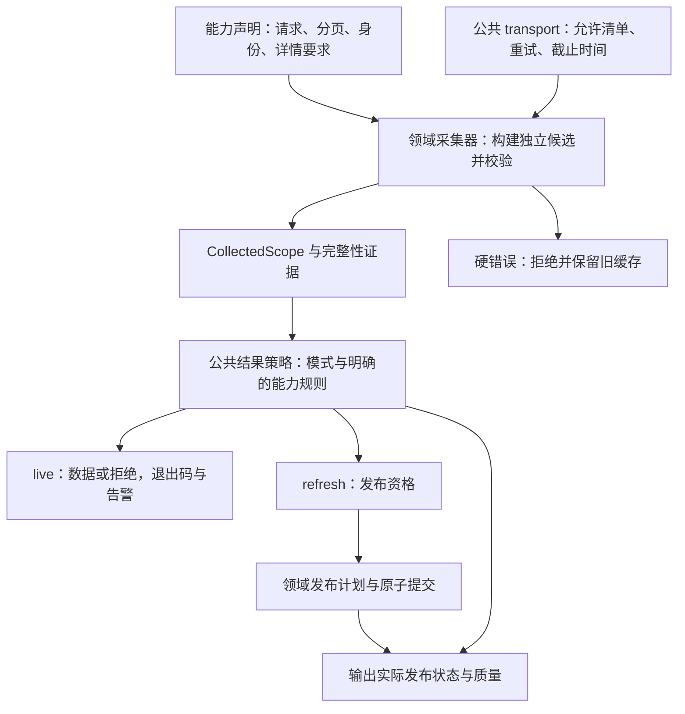

# 查询采集兼容与完整性处理的整体架构研究

Observed: 2026-10-03
Scope: general
Status: snapshot

Retired source references: local links removed by #255 now point to pinned release v0.4.3; this historical snapshot does not describe the current installed runtime.

后续业务取舍：用户要求默认允许发布与使用安全 incomplete 缓存；当前 feature branch 已按[统一 incomplete 规格](../../design/unified-incomplete-v0.1.0.md)与[ADR 0019](../../adr/0019-usable-incomplete-acquisitions.md)实施。本文保留原研究建议，不再代表当前分支的发布/退出码规则；实施及验收状态见该规格，历史研究不证明新策略的生产 UAT。

## 结论与适用范围

建议采用 **领域声明采集契约、公共层记录完整性证据并决定结果处置、领域存储执行原子发布** 的架构。统一错误、告警、退出码、发布状态和恢复边界；分页请求、总数语义、身份、详情要求与稳定性证明按已验证的能力契约保留差异。

第一步复用现有 `CollectedScope`、`execute_bounded` 和采集器注册机制，增加一个小型公共结果策略模块；先消除 live/refresh 的重复判断与 `schema_version` 耦合，再逐域迁移。当前规模不需要插件框架、通用工作流引擎、任意策略脚本或一套全新采集接口。现有分工见 [公共采集器](../../../src/dogopencli/collect.py#L55)、[采集器注册入口](https://github.com/proletariat64/dogopencli/blob/a7e5c5ead675487646eb9a53d73ec9e0aeb944f9/src/dogopencli/plugins/__init__.py#L157)和 [ADR 0015](../../adr/0015-peer-domain-plugins-and-shared-auth.md)。

本报告是建议与源码观察，尚未成为已接受 ADR、GitHub 规格或已交付功能。没有修改业务代码、创建 Issue、调用生产浏览器或重跑 UAT。

后续完整 UAT 准备已实施两项独立窄修复：holdings 加入部分结果告警分支；有身份的 single-response 同时核对原始到达数与唯一数。下文的 9 个告警路由及 `complete=true` 合成风险描述保留为修正前研究快照；现有告警路由为 10 个，single-response 回归已补齐。完整验收另见[本轮 UAT](2026-10-03-liquidity-full-cli-uat.md)。这些修复不表示本文提出的公共策略模块或跨领域迁移已经实施。

## 证据基线与当前差异

研究对象是 `feat/sub-cmd-lm` 当前工作树，HEAD 为 `a01562075f31eab50224fb35eea1de0cd27867f8`，包含已有未提交实施。code-review-graph 索引在该 HEAD 上构建，但不能代表全部未提交文件；本次仅用于定位，行为结论逐项核对实际源码，并通过导入当前 `src` 的只读脚本统计注册表。知识库先执行 graphify 检索，命中历史领域/渠道分页资料，没有提供本 CLI 兼容策略的直接证据，因此不用于证明当前后端契约，也未重建知识图谱。

| 观察 | 当前证据与影响 |
| --- | --- |
| Liquidity 有 46 个可执行 list 路由，9 个进入专用 incomplete 分支 | 按 [LIST_LEAVES](https://github.com/proletariat64/dogopencli/blob/a7e5c5ead675487646eb9a53d73ec9e0aeb944f9/src/dogopencli/plugins/liquidity/leaves.py#L2480) 与 [live 条件](https://github.com/proletariat64/dogopencli/blob/a7e5c5ead675487646eb9a53d73ec9e0aeb944f9/src/dogopencli/plugins/liquidity/query.py#L359)统计；returns 有两个请求变体，仍只算一个路由。 |
| 告警开关借用了缓存版本 | live 与 refresh 都检查 `schema_version` 或 accounts/returns 路径；[版本字段](https://github.com/proletariat64/dogopencli/blob/a7e5c5ead675487646eb9a53d73ec9e0aeb944f9/src/dogopencli/plugins/liquidity/spec.py#L112)本应隔离缓存契约，不应决定部分结果的退出码。 |
| 其余 37 个 Liquidity list 的普通 live 可以不完整但退出 0 | [live 返回](https://github.com/proletariat64/dogopencli/blob/a7e5c5ead675487646eb9a53d73ec9e0aeb944f9/src/dogopencli/plugins/liquidity/query.py#L408)只在专用分支传入 error；[输出函数](https://github.com/proletariat64/dogopencli/blob/a7e5c5ead675487646eb9a53d73ec9e0aeb944f9/src/dogopencli/plugins/liquidity/query.py#L87)据 error 决定退出码。严格 live 与 refresh 仍拒绝。 |
| Payment 也存在同类差异 | [cost 普通 live](../../../src/dogopencli/cli.py#L527)、[SLA 普通 live](../../../src/dogopencli/cli.py#L785)、[channel 普通 live](../../../src/dogopencli/cli.py#L316)可仅标记 `complete=false`；不能只改 Liquidity 后声称全局已统一。 |
| 部分 Collection 与 Payment 列表当前普通 live 就要求完整 | [Collection cost 解析](https://github.com/proletariat64/dogopencli/blob/a7e5c5ead675487646eb9a53d73ec9e0aeb944f9/src/dogopencli/plugins/collection/cost.py#L84)、[Collection SLA](../../../src/dogopencli/cli.py#L1033)、[VA rules](../../../src/dogopencli/cli.py#L1140)、[VA capacity](../../../src/dogopencli/cli.py#L1300)、[配置/付款规则通道](../../../src/dogopencli/cli.py#L1351)保留完整性拒绝，迁移时不能悄悄放宽。 |
| holdings 默认页宽已变化 | 当前 [holdings 声明](https://github.com/proletariat64/dogopencli/blob/a7e5c5ead675487646eb9a53d73ec9e0aeb944f9/src/dogopencli/plugins/liquidity/leaves.py#L394)为 **500**，与[现有测试](https://github.com/proletariat64/dogopencli/blob/a7e5c5ead675487646eb9a53d73ec9e0aeb944f9/tests/unit/plugins/liquidity/test_collect.py#L229)一致；上一轮报告的默认 10 已不适用。这不是本次生产全量验证。 |

原有 9 个 Liquidity 告警路由是 cash accounts、investment returns、forecast results、cash balances、cash groups、cash group-balances、cash pools、cash credit-lines、cash statements end-of-day。大页配置只改变取数策略，不意味着接入告警，也不意味着后端已修复。

## 三层职责与最小接口

### 领域采集契约

插件继续拥有请求构造、响应解析、scope 校验、原生身份、分页推进方式、总数语义与业务一致性证明。公共策略不能用 endpoint 名称猜规则，也不能捕获所有 `CliError` 并转成部分成功。现有 [EndpointContract](https://github.com/proletariat64/dogopencli/blob/a7e5c5ead675487646eb9a53d73ec9e0aeb944f9/src/dogopencli/plugins/__init__.py#L20)、[ListSpec](https://github.com/proletariat64/dogopencli/blob/a7e5c5ead675487646eb9a53d73ec9e0aeb944f9/src/dogopencli/plugins/liquidity/spec.py#L84)与领域采集器已提供主要声明位置。

保留目前的 pageNo、rowStart、single-response 循环，不先强行合成一个 paginator。复用 [collect_complete_scope](https://github.com/proletariat64/dogopencli/blob/a7e5c5ead675487646eb9a53d73ec9e0aeb944f9/src/dogopencli/plugins/__init__.py#L208)中已有的域采集器分派；Liquidity 的 capability 形状不完全等同于核心 `Capability`，若接入该入口，需要一个窄适配器，不通过强制类型转换掩盖差异。

### 完整性证据

建议在现有 `CollectedScope` 上增加一个带默认值的证据字段，避免第一步更换全部调用者。下面是建议模型，不是已实现 API：

| 字段 | 含义与约束 |
| --- | --- |
| `reported_total` | 后端真正报告的数量；未报告时为 null，不能把推导值冒充后端值。现有 `total_count` 暂保留兼容。 |
| `arrivals` | 当前候选在领域解析后的原始主记录到达数，去重前计数；必须与 total 采用同一计数单位。 |
| `collected_total` | 当前候选可返回的有效主记录数量，展示筛选前。 |
| `unique_count`、`duplicate_count` | 仅当契约有原生身份时计算；无身份的重复行次保留，不能用整行哈希猜身份。 |
| `reasons` | 内部结构化原因，如数量缺口、重复到达、域一致性不满足；不靠错误 message 解析原因。 |
| `attempts` | 精简的候选页宽、页数、完成状态与恢复原因；不存生产响应、真实业务 ID 或请求原文。 |
| `scope_complete`、`dataset_complete` | 分别描述当前请求范围的覆盖与此次要求的数据组成；详情完成度与列表覆盖分开。 |

对固定总数且有身份的分页契约，默认完成条件仍为 `arrivals == reported_total == unique_count`，并且 scope、字段与一致性验证全部通过。当前核心与 Liquidity offset 已使用该规则，见 [核心判断](../../../src/dogopencli/collect.py#L239)和 [offset 判断](https://github.com/proletariat64/dogopencli/blob/a7e5c5ead675487646eb9a53d73ec9e0aeb944f9/src/dogopencli/plugins/liquidity/collect.py#L131)。

single-response、无身份行次和动态总数由各自契约提供证明：不能把“三数相等”无条件施加到全部接口；也不能以未报告总数为由自动认定任何响应完整。现有 [single-response](https://github.com/proletariat64/dogopencli/blob/a7e5c5ead675487646eb9a53d73ec9e0aeb944f9/src/dogopencli/plugins/liquidity/collect.py#L143)是明确声明的整范围单响应合同。

### 公共结果策略与发布结果

建议新增 `src/dogopencli/result_policy.py`，只接受候选质量、运行模式、`--require-complete` 与明确的能力规则，返回：是否暴露可用数据、是否具备发布资格、告警/error、应有退出码。它不发请求、不排序、不打印、不写 SQLite。

将正常 live 的规则声明为 `partial_with_error` 或 `complete_only`；后者用于保留已经要求完整的能力。默认拒绝不完整列表的发布。VA 的详情容错为独立的发布规则，由领域证明“完整列表＋精确匹配的详情拒绝”后提供资格，不能只凭两个布尔量批准例外。

发布资格不等于 `published=true`。领域存储完成原子提交后，返回实际发布结果，再由公共输出报告。避免为告警而在提交后抛出普通异常，丢失已写入事实：当前 [VA refresh](https://github.com/proletariat64/dogopencli/blob/a7e5c5ead675487646eb9a53d73ec9e0aeb944f9/src/dogopencli/plugins/collection/va_rule_inquiry.py#L169)已发布后才抛 `INCOMPLETE_RESULT`，调用者因此无法进入[正常输出](../../../src/dogopencli/cli.py#L1113)。迁移应返回带 snapshot/质量的刷新结果，由 CLI 输出并退出 1。

`schema_version` 只用于原有缓存隔离；分页页宽保持现有声明为唯一来源。不同时引入另一套 `initial_page_size` 配置制造双重真值。将来的 `running_total` 等字段整理由独立重构处理，第一阶段直接从已有契约适配成内部策略。

## 对外行为矩阵

下表是建议目标。共用一套决策函数不意味着所有能力允许相同的降级；一致性体现在相同规则产生相同结果、差异均由具名契约解释。

| 模式与候选 | 返回数据 | 状态与退出码 | 缓存行为 |
| --- | --- | --- | --- |
| 普通 live，完整 | 正常展示窗口 | `complete=true`，退出 0 | 不写缓存 |
| 普通 live，可验证但覆盖不完整，允许部分 | 可用数据，保留排序/fields/limit/offset | `INCOMPLETE_RESULT`、warnings、`complete=false`，退出 1 | 不写缓存 |
| 普通 live，不完整，能力要求完整 | `data=null` | `INCOMPLETE_RESULT`，退出 1 | 不写缓存 |
| 严格 live，不完整 | `data=null` | `INCOMPLETE_RESULT`，退出 1 | 不写缓存 |
| 普通 refresh，完整且发布验证通过 | 保留既有刷新摘要 | 提交成功后 `published=true`，退出 0 | 原子发布 |
| 普通 refresh，列表不完整 | 可按能力规则返回本次临时行，或 `data=null` | `INCOMPLETE_RESULT`、`published=false`，退出 1 | 原有快照、索引、retention 内容保持原样 |
| VA rules refresh，列表完整，部分详情明确被拒绝 | 既有摘要与拒绝计数 | `complete=true`、`dataset_complete=false`、`published=true`、`INCOMPLETE_RESULT`，退出 1 | 依 ADR 0010 发布最新完整列表与 null 详情 |
| 硬失败 | `data=null` | 保留真实错误码与失败退出码 | 不发布候选；live 不回退旧缓存 |

保留现有 `{data, meta, error}` 包络；JSON warnings 与 stderr 对应同一条告警，table 也显示完整性并输出 stderr 告警，输出形式不能改变退出码。`reported_total`、`collected_total` 在本地筛选前计算，`matched_total` 在筛选后、展示窗口前计算，`returned_count` 是实际展示数；`--limit 1` 不能将不完整集合变成完整。

`has_more` 仍表示已获取匹配集合中的展示分页，不表示后端覆盖证明；不完整结果的空窗口不能证明后端无记录，全局排名也不能基于部分集合宣称完整。沿用 [ADR 0003](../../adr/0003-local-query-snapshots.md)中的范围与排序要求。

`complete` 保留其现有后端范围覆盖含义，不改成“没有任何质量告警”。VA 缺详情时为 true，`dataset_complete=false`；保留淘汰后 complete 只针对准确保留范围。新鲜度、模拟来源与完整性继续独立。离线普通读取的现有退出码暂保留，`--require-complete` 继续按原能力要求拒绝；本报告的第一轮统一范围是采集型 live/refresh，不将离线历史行为顺带改动。

统一对 refresh 增加真实 `meta.published` 是建议的增量变更，保留既有 `data.published`；硬失败时只在确定没有提交的刷新上下文输出 false，不对 live 或普通缓存读取虚构发布状态。VA 的发布状态必须来自提交结果。

## 兼容策略目录与不能放宽的边界

| 能力/协议 | 保留的取数与证明规则 | 统一后归属 |
| --- | --- | --- |
| Payment cost / SLA | 5000；不完整时允许一次 10000 全量重建，候选独立，共享截止时间 | 域声明已验证容量；核心执行重建，公共策略处理最终候选 |
| Collection cost | 固定 pageNo=0、pageSize=1000，解析时即要求单页完整；没有重建或分页 fallback | 复用核心机制，但保持自身完整单页合同，不能套用 Payment cost 的 10000 |
| Payment channel | 原分页；没有大页重建条款；snapshot 替代源保持独立命名空间与完整性 | 不凭同属 Payment 套用成本恢复规则 |
| Collection VA capacity | `running_total=True`；到首个短页才停，以最后 total 核对；整页倍数需最终空页 | 具名动态总数契约；其他固定总数仍拒绝变化 |
| Liquidity offset | rowStart 按配置 pageSize 推进，固定 total、身份与 scope；短页不擅自变成结束条件 | 现有 offset 适配器＋公共结果策略 |
| Liquidity single response | 正好一个验证过的整范围请求；无分页接口不增加分页字段 | 保留 single 合同；无原生身份保留重复行次 |
| Liquidity 大页能力 | 现有 5000/1000/500/100/30 等各自页宽继续有效 | 初始策略配置，不是完整性豁免，也不是通用 fallback |
| Collection VA rules | 完整列表为先决条件；仅 HTTP 200、有效包络且 `success=false` 的单详情拒绝可容忍 | 域聚合与发布例外；不扩展到 SLA 或 Liquidity detail |
| Payment/Collection SLA | 保留要求的列表＋真实详情耦合采集与发布 | 公共层不取消必需详情 |
| Liquidity detail | 与列表独立采集和缓存；不拿列表行当真实详情 | 独立详情发布器，不加入强制全量详情抓取 |
| PTR cases / orders | 两轮完整内容一致；orders 在扩大后的取数范围证明稳定，再裁业务窗口 | 继续使用已注册 collector；不因 count 相等取消稳定证明 |

目录依据：[Payment cost contract](https://github.com/proletariat64/dogopencli/blob/a7e5c5ead675487646eb9a53d73ec9e0aeb944f9/src/dogopencli/plugins/payment/cost.py#L39)、[Collection cost contract](https://github.com/proletariat64/dogopencli/blob/a7e5c5ead675487646eb9a53d73ec9e0aeb944f9/src/dogopencli/plugins/collection/cost.py#L34)、[SLA contract](https://github.com/proletariat64/dogopencli/blob/a7e5c5ead675487646eb9a53d73ec9e0aeb944f9/src/dogopencli/plugins/payment/sla.py#L44)、[核心恢复](../../../src/dogopencli/collect.py#L88)、[VA capacity](https://github.com/proletariat64/dogopencli/blob/a7e5c5ead675487646eb9a53d73ec9e0aeb944f9/src/dogopencli/plugins/collection/va_capacity.py#L40)、[VA refusal 发布](https://github.com/proletariat64/dogopencli/blob/a7e5c5ead675487646eb9a53d73ec9e0aeb944f9/src/dogopencli/plugins/collection/va_rule_inquiry.py#L124)、[PTR 稳定采集](https://github.com/proletariat64/dogopencli/blob/a7e5c5ead675487646eb9a53d73ec9e0aeb944f9/src/dogopencli/plugins/payment/ptr.py#L238)、[orders 裁窗](https://github.com/proletariat64/dogopencli/blob/a7e5c5ead675487646eb9a53d73ec9e0aeb944f9/src/dogopencli/plugins/payment/ptr_orders.py#L357)。

固定总数变化、同身份内容冲突、scope/回显不匹配、未知包络、认证或权限错误、一般业务失败、超时、无进展、页预算耗尽继续硬拒绝，不能用重采或普通 live 降级隐藏。核心 `consistency_field` 目前会把不同内容表现为 `complete=false`；需要单独记录其原因，不能将它与原生身份冲突混同，更不能把任意“不完整”都解释成容量问题。见 [核心一致性记录](../../../src/dogopencli/collect.py#L205)与 [共享重试边界](../../../src/dogopencli/collect.py#L272)。

### 将来的大页/小页恢复

[历史后续要求](2026-10-01-pagination-followups.md)提到“大页失败后缩小分页”，当前尚未通用实现。建议允许将来把现有单次大页重建表述为有限的具名恢复步骤，但本轮不创建未经验证的全局 `5000 → 1000 → 100 → 10` 阶梯。

每个恢复步骤必须声明：适用 capability/variant、允许的页宽、触发原因、取数语义证据、最大候选数。现有 Cost/SLA 的 5000→10000 保持原触发行为；新增缩页只有在明确容量拒绝或经验证的覆盖缺口时启用，不能捕获一般业务错误。恢复方向可以增大或缩小，依据端点合同，而不是统一固定方向。

候选之间不拼接，不拿旧缓存补洞；每轮从起点完整构建。固定总数只在同一候选内保持稳定，独立重建的新候选可以有不同总数，但也必须独立满足完整性；[现有成本测试](https://github.com/proletariat64/dogopencli/blob/a7e5c5ead675487646eb9a53d73ec9e0aeb944f9/tests/integration/test_cost_cli_sit.py#L605)已覆盖前轮 total=9、后轮 total=8。重试、重采和 PTR 二轮证明共享剩余预算，不能每步重置为 900 秒。中间失败但最终独立候选完整时可退出 0，同时保留恢复摘要，不将中间候选行混入结果。

## 现有架构约束与额外发现

本方案遵守 [ADR 0003](../../adr/0003-local-query-snapshots.md)、[ADR 0015](../../adr/0015-peer-domain-plugins-and-shared-auth.md)、[ADR 0016](../../adr/0016-liquidity-independent-list-and-detail-caches.md)和 [ADR 0018](../../adr/0018-liquidity-capture-store-and-retention.md)。VA 部分详情发布依 [ADR 0010](../../adr/0010-collection-va-partial-detail-tolerance.md)，Channel snapshot 替代源依 [ADR 0005](../../adr/0005-channel-snapshot-source.md)；两个例外不能被通用“失败保留旧缓存”口号抹掉。

保留存储的原子边界：[Liquidity plan](https://github.com/proletariat64/dogopencli/blob/a7e5c5ead675487646eb9a53d73ec9e0aeb944f9/src/dogopencli/plugins/liquidity/store.py#L368)是验证与计划，[commit_plan](https://github.com/proletariat64/dogopencli/blob/a7e5c5ead675487646eb9a53d73ec9e0aeb944f9/src/dogopencli/plugins/liquidity/store.py#L618)一次提交 capture、index、trim 与删除。只有通过发布资格后才规划 retention，未发布候选不能触发淘汰；故意淘汰与采集缺数必须分开。运行态、配置态、参考信息的 profile 不因结果策略统一而改变。

另外发现一个独立完整性风险：single-response 有原生身份时先去重，再只核对 total 与去重后数量，没有核对原始到达数，见 [single collector](https://github.com/proletariat64/dogopencli/blob/a7e5c5ead675487646eb9a53d73ec9e0aeb944f9/src/dogopencli/plugins/liquidity/collect.py#L158)。本次用现有 fake transport 做了一次纯合成验证：两个完全相同的 product 行、total=1，当前结果为 `complete=true`、返回一行。它与 offset 的证明要求不一致；现有[单响应测试](https://github.com/proletariat64/dogopencli/blob/a7e5c5ead675487646eb9a53d73ec9e0aeb944f9/tests/unit/plugins/liquidity/test_collect.py#L164)没有覆盖这个组合。

建议把这项作为迁移前单独的窄修复：先补真实行为回归，再令有身份的单响应校验原始到达数与报告数，不把去重当作完整证明。无身份的 cashflows 行次仍应保留。此次没有修复，也不能由这个合成样例推断生产发生过该问题。

## 分步实施与停止条件

| 阶段 | 工作与可独立审查的产物 | 完成条件 |
| --- | --- | --- |
| 0：冻结行为 | 从当前注册表生成路由/variant/页宽/采集器/结果规则清单；记录独立 single-response 风险 | 46 个 Liquidity 路由和 Payment/Collection 的既有采集型入口都有明确映射，不靠名称推断 |
| 1：公共策略＋Liquidity | 小型 `result_policy.py`；live/refresh 使用同一决策，删除 schema_version/路径判断；接入全部 46 list | 普通可用 partial 都告警＋退出 1；严格不暴露数据；不完整 refresh 不写缓存；现有页宽与业务拒绝不变 |
| 2：Payment/Collection | 将 Payment 原有 partial live 接入同一规则；Collection/PTR 已要求完整的能力保留 `complete_only`；VA 改为返回真实发布结果 | 全部采集型入口不存在无声 incomplete 退出 0；VA 不因退出 1掩盖已发布事实；原生详情语义保留 |
| 3：证据与恢复整理 | 两种采集器填写统一 evidence，保留 pageNo/offset/single 循环；在已验证能力上复用有限重采执行器 | 原始计数、重复、恢复轮次可解释；不增加未经验证的页宽/缩页步骤；不移除域稳定性证明 |

第一阶段可以将 `CollectedScope.complete` 适配到公共策略，先不大改全部 collector；但不能根据现有 boolean 自动猜测恢复原因。新恢复步骤必须等待结构化证据与域验证。每阶段保留原有缓存 schema 和数据库布局，可通过回退代码撤销；质量规则变严是行为变更，须在 release note 与帮助/describe 中说明，不增加“静默兼容”开关延续假成功。

迁移正式立项时记录 GitHub Issue 与提出的 ADR；研究文档保持建议状态。本次无需创建规格镜像或 accepted ADR。统一普通 live 的退出码、VA 刷新发布状态和新增恢复步骤均应进入明确的验收条款。

## 验收矩阵与本次验证

实施时用现有 fake transport 与真实临时 SQLite 做定向验证，不建立只复述函数分支的测试：

1. **结果决策**：complete/安全 partial/hard error × 普通 live/严格 live/refresh × JSON/table，核对 data、error、warnings、退出码与真实发布状态；已有 complete_only 能力不能被放宽。
2. **分页证明**：固定 total、offset stride、短页、空页、缺数、相同重复、身份冲突、scope 错配、single 无 total、无身份重复行次；单响应的 arrivals=2、total=unique=1 应新增回归。
3. **恢复边界**：已声明的一次独立重建、无权限重建、硬失败不重建、独立候选不同 total、共享截止时间与预算耗尽；不能拼接候选。
4. **动态与详情契约**：VA 最后短页/空页收敛，固定 total 仍拒绝变化；VA 详情拒绝可发布且退出 1，403/解析/身份或共享字段冲突保留旧快照；PTR 双轮漂移仍拒绝。
5. **发布与展示**：失败前后检查记录、snapshot、index 与 retention 无变化；提交失败回滚；live 从不发布；limit/offset/fields 不改变质量；已发布 partial 的 VA 缺详情 get 为 incomplete，完整列表证明不存在的 ID 才为 NOT_FOUND。
6. **路由覆盖**：遍历实际注册表及请求变体检查规则存在；选代表能力通过真实 CLI 做行为验证，避免为全部 46 路由机械复制同一测试。

现有基线来自 [Liquidity collector 测试](https://github.com/proletariat64/dogopencli/blob/a7e5c5ead675487646eb9a53d73ec9e0aeb944f9/tests/unit/plugins/liquidity/test_collect.py)、[Liquidity CLI partial/cache 测试](https://github.com/proletariat64/dogopencli/blob/a7e5c5ead675487646eb9a53d73ec9e0aeb944f9/tests/integration/test_liquidity_cli_sit.py#L426)、[Forecast partial/cache 测试](https://github.com/proletariat64/dogopencli/blob/a7e5c5ead675487646eb9a53d73ec9e0aeb944f9/tests/integration/test_liquidity_spec76_cli_sit.py#L331)、[成本恢复测试](https://github.com/proletariat64/dogopencli/blob/a7e5c5ead675487646eb9a53d73ec9e0aeb944f9/tests/integration/test_cost_cli_sit.py#L456)、[VA capacity 测试](https://github.com/proletariat64/dogopencli/blob/a7e5c5ead675487646eb9a53d73ec9e0aeb944f9/tests/integration/test_collection_va_capacity_cli_sit.py#L193)、[VA rules 测试](https://github.com/proletariat64/dogopencli/blob/a7e5c5ead675487646eb9a53d73ec9e0aeb944f9/tests/integration/test_collection_va_rule_cli_sit.py#L396)。

本次实际运行：Liquidity collector 与 accounts partial/cache 的定向选择 **14 passed，45 deselected**；Forecast results partial/cache 测试 **1 passed**。共 15 项离线检查通过，另完成上述单响应风险的合成重现。业务测试没有验证尚未实施的公共策略；没有生产 UAT、全量 CI 或后端根因验证。本次文档通过仓库 `make doc-guard` 校验。
